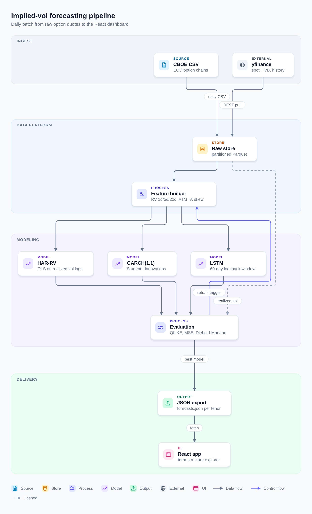
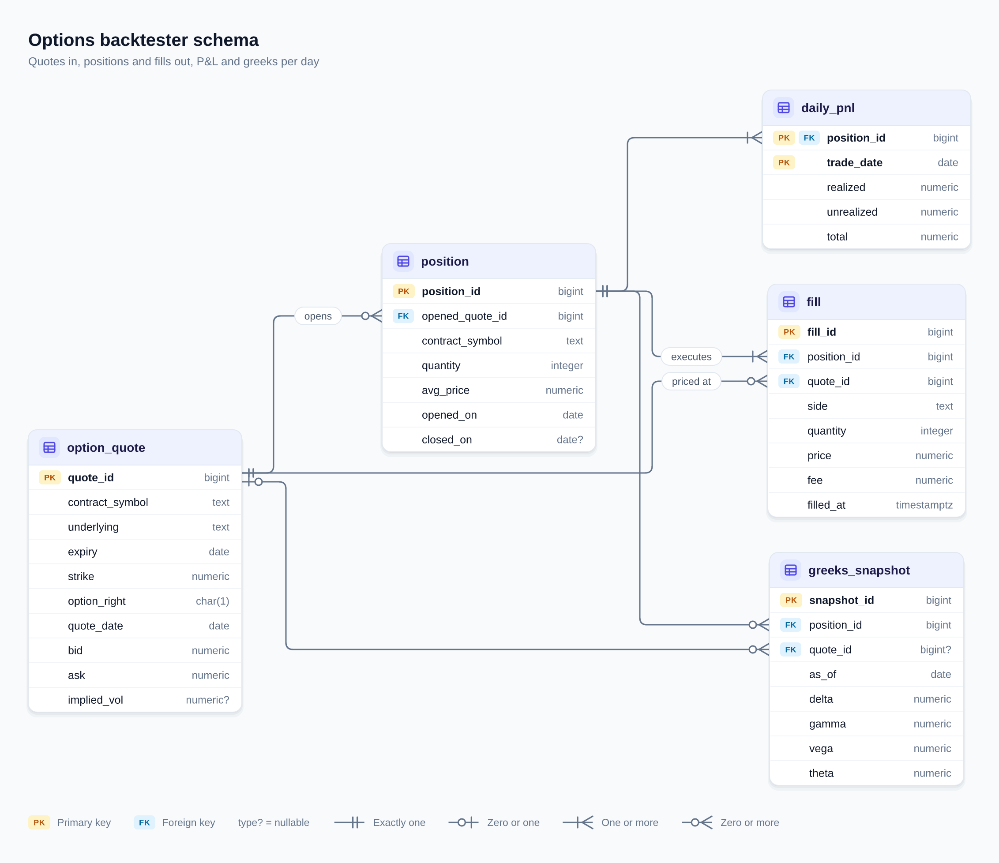
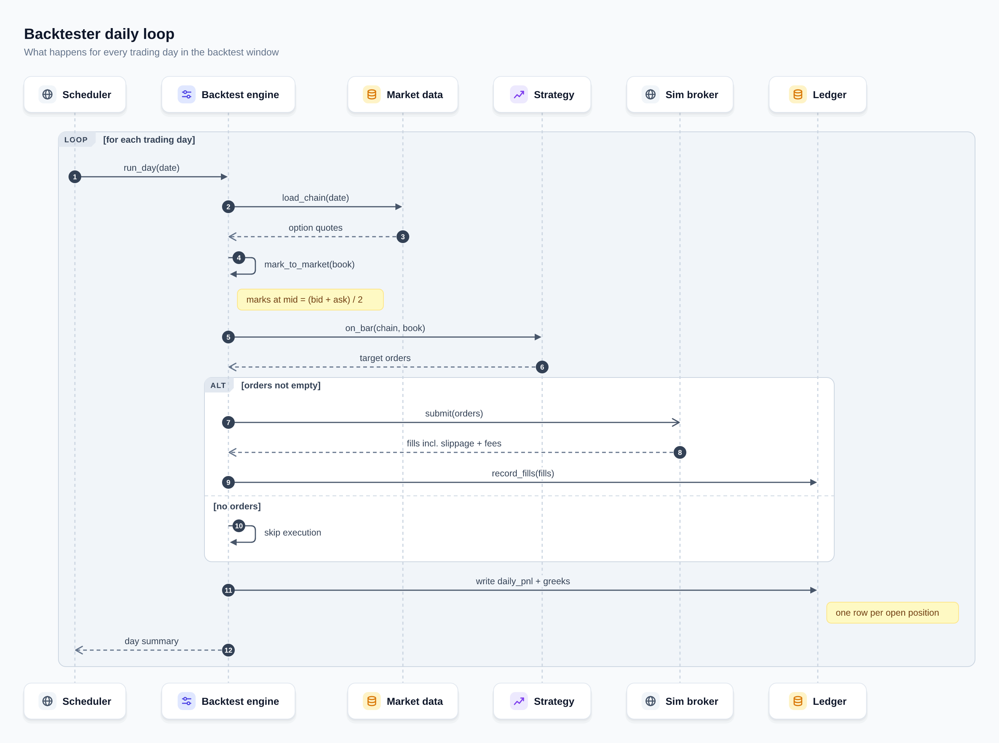

# vol-diagram-kit

Diagram-as-code for the vol learning repos. Write **one YAML spec**; get every
format the diagram is needed in, all generated from the same computed layout so
they never drift:

| output | file | for | import-tested |
|---|---|---|---|
| Mermaid | `<name>.mmd` | renders natively on GitHub (paste into a ` ```mermaid ` fence) | yes: parsed and rendered with Mermaid 12.2.0 (GitHub's) and 11.17.2, see [Validating Mermaid](#validating-mermaid-optional) |
| SVG | `<name>.svg` | docs/README embeds; the Figma import path | Figma / FigJam: **no** |
| PNG | `<name>.png` | 2× raster of the SVG for slides, chat, issues | n/a |
| draw.io | `<name>.drawio` | uncompressed mxGraph XML, opens editable in diagrams.net / draw.io | partly: loaded once in draw.io's own viewer (below); not opened in the editor |
| Lucidchart | `<name>.lucid.xml` | a conservative variant of the draw.io XML for Lucid's draw.io import | **no** |

Three spec kinds: `flow` (architecture, data-flow, process), `erd`, `sequence`
(sequence diagrams produce `.mmd`, `.svg`, `.png` only). The spec format is
documented with full examples in **[SCHEMA.md](SCHEMA.md)**.



<p>


</p>

## Format honesty

- **Figma / FigJam: import-tested: no.** Neither has an XML import. Figma's help
  centre documents that an imported SVG becomes editable vector layers in Figma
  Design. **FigJam's documented import types do not include SVG** (its help
  centre lists PNG, JPG, GIF, TIFF, WEBP, CSV, PDF and video); the documented
  ways to get vectors into FigJam are pasting from a Figma Design file or the
  Figma MCP `upload_assets` tool. The SVG is written for Figma: only `rect`, `circle`, `ellipse`, `path`, `polygon`,
  `text` and `g`; every colour and font as a presentation attribute; no
  `<style>`, CSS classes, filters, markers, `foreignObject`, images or `href`s;
  text stays real `<text>` so it remains editable; groups carry ids
  (`node_raw`, `edge_3`, `lane_modeling`) that become layer names. Shadows are
  stacked translucent rects, not filters. Fonts are requested as
  `Inter, 'Segoe UI', Roboto, Helvetica, Arial, 'Liberation Sans', sans-serif`
  and Figma ships Inter. A test enforces the allowed-element list.
- **Lucidchart: import-tested: no.** Lucid has no native XML format; its help
  centre documents importing draw.io files (`.drawio` or `.xml`) **directly**,
  so the `.drawio` file is the documented path. `.lucid.xml` is kept because
  Lucidchart files were asked for: the same XML, uncompressed, with
  conservative choices — plain rectangles with absolute coordinates (no
  swimlane containers, no `shape=` stencils, no table shapes), plain-text
  labels (`html=0`), plain `classic` arrowheads, ERD cardinality written into
  the edge label instead of draw.io's `ER*` arrowheads. It is a hedge in case
  Lucid drops draw.io-specific shapes, and it is **untested**. Lucid also says
  the file must have been exported from draw.io; these files are generated
  (`host="vol-diagram-kit"`), and whether Lucid accepts either one is unknown.
  The `.drawio` file uses the richer draw.io features (swimlane containers, ER
  table shapes with one row per column, crow's-foot arrowheads, HTML labels).
- **draw.io**: the test suite checks both XML files parse, have
  `mxfile/diagram/mxGraphModel/root`, cells `0` and `1`, **unique cell ids**
  (draw.io silently drops a cell whose id repeats), existing parents, vertex
  geometry on every box, edges whose source/target exist, the same boxes,
  waypoints and edge endpoints as the SVG (reconstructed from the XML), and
  that every `html=1` label, read as HTML, shows exactly the spec text with no
  stray tags (`<daily>` in a label would otherwise vanish as a tag). Once, on
  2026-10-28, the outputs of `tests/specs/` were also loaded in draw.io's own
  viewer (viewer.diagrams.net) in headless Chromium: every cell was kept and
  every label showed the spec text. That viewer run is not part of the suite,
  and the files were not opened in the draw.io editor.
- **Mermaid is laid out by Mermaid.** Same nodes, edges, labels, colours and
  lanes (as subgraphs), but Mermaid's own layout engine places them, so the
  GitHub rendering does not match the SVG geometry. Labels are escaped per
  Mermaid context (entity codes such as `#lt;`, `#58;`; edge labels quoted), and
  the few inputs Mermaid cannot show are rejected at validation with a rename
  suggestion: ids that are Mermaid keywords for that diagram type, ERD columns
  named `pk`/`fk`/`uk`, and `<` in a title (see [SCHEMA.md](SCHEMA.md)).

## Quick start

```bash
uv sync
uv run python build.py examples/specs --out examples/out           # build everything
uv run python build.py examples/specs --out examples/out --check   # exit 1 if outputs are stale
uv run python build.py examples/specs --out examples/out --only iv_forecast_pipeline
uv run pytest                                                       # test suite
```

`--check` regenerates every output into a temporary directory and compares it
byte-for-byte with `--out`. It exits `1` and lists each file as `differs`,
`missing`, or `stale` (an output with no spec behind it, or a format the spec's
kind does not produce), `2` on a spec error, `0` when everything is current.
With `--only NAME`, `--check` judges only NAME's files: a stale `NAME.drawio`
is still reported, but outputs left behind by other or deleted specs are not —
run the full `--check` in CI. `--no-png` skips rendering and comparing PNGs;
`--renderer {resvg,cairosvg,playwright}` picks the PNG backend.

Spec errors are reported all at once, with a path, before anything is written:

```text
docs/diagrams/specs/pipeline.yaml: 2 errors
  - nodes[4].type: 'modle' is not one of source, store, process, model, output, external, ui (did you mean 'model'?)
  - edges[2].to: unknown node 'featurs' (did you mean 'features'?)
```

## Determinism

Same input → byte-identical output. Layout is iterated in declaration order
with index tie-breaks (no set/dict-order dependence; a test builds in two
processes with different `PYTHONHASHSEED` and compares bytes), numbers are
rounded to a fixed 2 decimals (4 for mxGraph relative positions), there are no
timestamps, absolute paths or generator versions in any file, and the PNG
encoder writes no `tIME`/`tEXt` chunks. Text is measured from a baked
advance-width table of the bundled font
([`diagram_kit/_font_metrics.py`](diagram_kit/_font_metrics.py), regenerated by
`scripts/gen_font_metrics.py`), not from whatever fonts the machine has.

PNG bytes additionally depend on the resvg version (pinned) and the font files
(bundled). They were identical across repeated builds here, but **PNG bytes are
only verified on aarch64**; they were never compared across CPU architectures.
GitHub's hosted runners are x86_64, so **in CI on x86_64 run
`--check --no-png`**: it still checks every `.mmd`, `.svg`, `.drawio` and
`.lucid.xml` byte for byte, and the PNG is a raster of the SVG it checked.

## PNG renderer: what was probed and why resvg

Probed on this machine (aarch64 Linux, NVIDIA GB10, Ubuntu, Node 22), in the
requested order:

| backend | result |
|---|---|
| `cairosvg` 2.9.1 (needs system libcairo; present here) | **Works**, ~0.02 s for the probe SVG. Text renders and is legible. But cairosvg hands the whole CSS `font-family` list to fontconfig, which does not walk it: with the Inter-first stack it rendered **DejaVu Sans**, the fontconfig default. Measured on the example labels, DejaVu is 7–17 % wider than the metrics the layout uses, and cairosvg cannot be pointed at bundled font files — so the PNG depends on each machine's fontconfig. No SVG filter support (the SVG uses none). |
| `resvg-py` 0.5.0 (prebuilt aarch64 wheel, no system libraries) | **Works**, ~0.04 s. Walks the CSS font-family list properly, renders with explicitly loaded font files and system fonts switched off, identical bytes on repeat renders. **Chosen.** |
| Playwright 1.64.1 + Chromium | Works only by passing `executable_path` to the already-cached Chromium build 1234 (the pinned Playwright expects build 1248; `playwright install` was not run). ~0.65 s per render. Uses system fonts (DejaVu Sans again). |

The brief said to pick the first backend that works and renders text
correctly. cairosvg comes first and does render text, so choosing resvg is a
judgment call: the kit's core promise is byte-identical output and `--check`,
and only resvg can render with the same fonts on every machine. cairosvg and
Playwright stay available as pluggable fallbacks
(`--renderer cairosvg` with `uv sync --extra cairo`;
`--renderer playwright` with `uv sync --extra browser` and
`DIAGRAM_KIT_CHROMIUM=/path/to/chrome` or a `playwright install chromium`).
The renderer can also be set with `DIAGRAM_KIT_PNG_RENDERER`.

Bundled font: Liberation Sans 2.1.5 Regular + Bold (SIL OFL 1.1, Arial/Helvetica
metrics), copied unmodified from Ubuntu's `fonts-liberation`; licence in
[`diagram_kit/fonts/OFL.txt`](diagram_kit/fonts/OFL.txt). ~825 KB.

## Vendoring into a repo

The kit is a plain package plus one script; nothing is installed.

1. **Copy** the package and the entry point into `tools/diagrams/`:

   ```bash
   mkdir -p tools/diagrams
   rsync -a --exclude __pycache__ /path/to/vol-diagram-kit/diagram_kit /path/to/vol-diagram-kit/build.py tools/diagrams/
   mkdir -p docs/diagrams/specs docs/diagrams/out
   ```

   `build.py` puts its own directory on `sys.path`, so it runs from any working
   directory.

2. **Add the two runtime dependencies** to the repo's `pyproject.toml`, in a
   dependency group so they stay out of the app's runtime deps:

   ```bash
   uv add --group diagrams pyyaml==6.0.3 resvg-py==0.5.0
   ```

   which writes

   ```toml
   [dependency-groups]
   diagrams = ["pyyaml==6.0.3", "resvg-py==0.5.0"]
   ```

   Tested on Python 3.12 only.

3. **Write specs** in `docs/diagrams/specs/*.yaml` (see [SCHEMA.md](SCHEMA.md)).

4. **Build / check**:

   ```bash
   uv run --group diagrams python tools/diagrams/build.py docs/diagrams/specs --out docs/diagrams/out
   uv run --group diagrams python tools/diagrams/build.py docs/diagrams/specs --out docs/diagrams/out --check
   uv run --group diagrams python tools/diagrams/build.py docs/diagrams/specs --out docs/diagrams/out --only pipeline
   ```

   Commit the specs **and** `docs/diagrams/out/`. In CI, run the `--check`
   line (with `--no-png` on x86_64 runners, see Determinism); a contributor who
   edits a spec without rebuilding gets a non-zero exit naming every stale file.

5. **Embed**: `` in Markdown, or
   paste `pipeline.mmd` into a ` ```mermaid ` fence for GitHub-native
   rendering.

A test (`test_runs_from_any_cwd_when_vendored`) does exactly steps 1 and 4 in a
scratch repo and checks the outputs equal `examples/out/` byte for byte.

## Validating Mermaid (optional)

`tests/test_mermaid_render.py` parses **and renders** every example and every
spec in `tests/specs/` with the Mermaid that GitHub uses (12.2.0, initialised
like GitHub's viewer: `securityLevel: "antiscript"`) in headless Chromium, and
asserts that every title, label, sublabel, column, note and block label
appears in the rendered text as many times as the spec puts it there.
`tests/specs/adversarial_*.yaml` put every printable ASCII punctuation mark
plus `σ² →` in every label position. Two negative controls prove the harness
can fail: the old kit's unquoted `-->|fit (daily)|` must fail to parse, and a
raw `<id>` in an ERD alias must be reported missing. Skipped (with the reason)
unless Playwright, a Chromium and the Mermaid bundle are available:

```bash
mkdir -p /tmp/m12 && cd /tmp/m12 && npm install --ignore-scripts mermaid@12.2.0 && cd -
uv sync --extra browser
DIAGRAM_KIT_MERMAID_JS=/tmp/m12/node_modules/mermaid/dist/mermaid.min.js \
DIAGRAM_KIT_CHROMIUM=$HOME/.cache/ms-playwright/chromium-1234/chrome-linux/chrome \
  uv run pytest tests/test_mermaid_render.py
```

`DIAGRAM_KIT_MERMAID_VERSION=11.17.2` with that version's bundle runs the same
checks against mermaid-cli's Mermaid; both pass here. GitHub's version was read
from its viewer bundle (`viewscreen.githubusercontent.com`, 2026-10-28) and
will drift; rerun with the new version when it does.

`tests/test_mermaid_cli.py` additionally parses and renders every generated
`.mmd` with `@mermaid-js/mermaid-cli` and is skipped unless `DIAGRAM_KIT_MMDC`
is set. It was run here against mermaid-cli 11.17.0 (mermaid 11.17.2), driving the
already-cached Playwright Chromium so Puppeteer downloads nothing:

```bash
mkdir -p /tmp/mmdc && cd /tmp/mmdc
PUPPETEER_SKIP_DOWNLOAD=1 npm install --ignore-scripts @mermaid-js/mermaid-cli@11.17.0
cd -
DIAGRAM_KIT_MMDC=/tmp/mmdc/node_modules/.bin/mmdc \
PUPPETEER_EXECUTABLE_PATH=$HOME/.cache/ms-playwright/chromium-1234/chrome-linux/chrome \
  uv run pytest tests/test_mermaid_cli.py
```

The suite includes a deliberately broken input that must fail, so a passing run
means mmdc really parsed the files. It checks the exit code only, not the
rendered text; the render test above is the one that does.

## How the layout works

[`diagram_kit/layered.py`](diagram_kit/layered.py) is a small Sugiyama-style
layered layout written for this kit (grandalf was considered; it has no
cluster/lane support and no orthogonal routing, which were the hard parts):

1. break cycles by DFS in declaration order (the closing edge is routed
   backwards, arrow still at its real target);
2. longest-path ranking, then pull pure sources next to their first consumer;
3. pack lanes into tracks — lanes with disjoint rank ranges share a row
   (pipeline stages), overlapping ones stack (actor swimlanes);
4. dummy nodes on long edges; barycenter sweeps keep the ordering with fewest
   crossings;
5. cross-axis placement by repeated neighbour averaging, solved per stack with
   isotonic regression (keeps order and gaps), then long-edge corridors are
   straightened and near-straight jogs snapped;
6. ports spread along card sides (ERD: the exact column row), spaced so a
   label pill never sits over a neighbouring edge; where one edge would leave a
   rank on the same line another enters the next rank (they would read as one
   line), an auto port slides off that line; every vertical hop in a gap gets
   its own channel, hops less than 12 px apart never share one; edge labels are
   packed into a label zone beside the target, and gap widths are sized from
   what they must hold;
7. lanes are at least as wide as their label (LR: the lane box reaches into
   the gaps on both sides; TB: the band is widened).

Tests check the invariants on the shared scene for the examples, the specs in
`tests/specs/` (adversarial labels, the 15-node / 4-lane review stress flow in
LR and TB) and extra shapes (TB, stacked swimlanes, long edges, a 3-cycle, long
lane labels): no overlapping cards, no edge through a card, orthogonal edges
starting/ending on their cards (ERD: on their rows), labels on their own edge
and not on cards, other labels or other edges, flow edges never closer than
12 px side by side or end to end, lane labels inside their lanes, cards inside
their lanes, everything inside the canvas.

### Wide flows: use `direction: TB`

An LR flow is as wide as all its ranks together: the 7-rank pipeline example
is 2505 px wide in LR and the 15-node review stress flow 4262 px, so a README
column (~900 px) shows them at 36 % and 21 %. In TB the width is the widest
*rank* instead, and the height grows with the rank count, which a README
scrolls through. The shipped pipeline example therefore uses `direction: TB`:
900 px wide (PNG 1800 px), shown at full size. The stress flow in TB is
1102 px wide (PNG 2204 px); its widest rank holds a deliberately oversized
424 px card, and only text wrapping (not implemented) would make it narrower.
Tighter rank spacing was not enough (it saves tens of pixels, not thousands),
and wrapping one LR row into several would need long backward edges between
rows. Rule of thumb: LR up to about four ranks, TB beyond.

## Known limitations

- **No text wrapping.** Labels are single lines; long labels make wide cards.
- **Character set**: only what Liberation Sans covers in the baked table
  (ASCII, Latin-1, a few typographic and Greek/math symbols). Emoji, `⇒`, CJK
  are rejected by validation rather than rendered as tofu.
- **Font substitution**: the PNG uses Liberation Sans. The SVG asks for Inter
  first; viewers without Inter fall back. Boxes reserve 10 % extra width; a
  fallback much wider than Inter (DejaVu Sans is up to ~17 % wider than
  Liberation) can make the right padding of a card tight.
- **Not supported**: self-loops in flows, self-referencing foreign keys,
  ERD direction other than left→right, sequence activations / `par` /
  `critical` / notes left-of or over, nodes outside lanes when lanes exist.
- **Crossing minimisation is heuristic** (barycenter sweeps). Dense graphs can
  still cross.
- **ERD edge separation is not guaranteed.** ERD ports are fixed to column
  rows and cannot slide, so the 12 px separation is enforced for flows only.
  Relations that leave one row with different parent-end markers use sub-ports
  10 px apart by design, and in an 8-entity / 15-relation stress ERD two long
  relation corridors pass 7 and 9 px from another relation's stub.
- **Wide LR flows**: see "Wide flows" above.
- **draw.io / Lucid files omit the legend** (it is decoration in the SVG).
- **Lucidchart and Figma/FigJam imports are untested** (see above); draw.io was
  only checked with its viewer, not opened in the editor.
- PNG byte-identity across CPU architectures is unverified (see Determinism).

## Tests and mutation check

`uv run pytest -q` on a fresh clone after `uv sync`: **126 passed, 24
skipped** (measured 2026-10-28, aarch64). With `uv sync --all-extras`
(cairosvg, Playwright): **127 passed, 23 skipped**. The remaining skips need
`DIAGRAM_KIT_MERMAID_JS` (Mermaid render test, 14), `DIAGRAM_KIT_MMDC`
(mermaid-cli, 8) or `DIAGRAM_KIT_CHROMIUM` (Playwright PNG fallback, 1); with
all of them set: **150 passed**.

`uv run python tests/mutants.py` breaks the code one way at a time in a
scratch copy (never the working tree) and runs only the tests meant to catch
that breakage: Mermaid escaping per character and context, keyword ids, the
`<` title rule, each validation cascade, the old draw.io row ids, draw.io HTML
escaping of every label kind, lane label widths, the collinear-stub repair,
the 12 px channel margin, label-aware port spacing and `--only` stale
detection. Each must be reported `KILLED`; the Mermaid ones need the render
test's environment variables, otherwise they show `SKIPPED`.

## Repository layout

```text
build.py                  CLI entry point (vendor this)
diagram_kit/              the package (vendor this)
  spec.py                 YAML loading + validation
  layered.py              layered layout + orthogonal routing
  flow.py erd.py sequence.py   scenes + SVG
  mermaid.py mxgraph.py   Mermaid / draw.io / Lucid emitters
  png.py                  pluggable PNG backends
  fonts/                  Liberation Sans + OFL licence
scripts/gen_font_metrics.py   regenerate the width table (dev only, needs fontTools)
examples/specs/ examples/out/ three worked examples and their committed outputs
tests/                    pytest suite
  specs/                  adversarial labels, draw.io id collisions, near-keyword ids, stress flow
  mutants.py              mutation check (see "Tests and mutation check")
```
